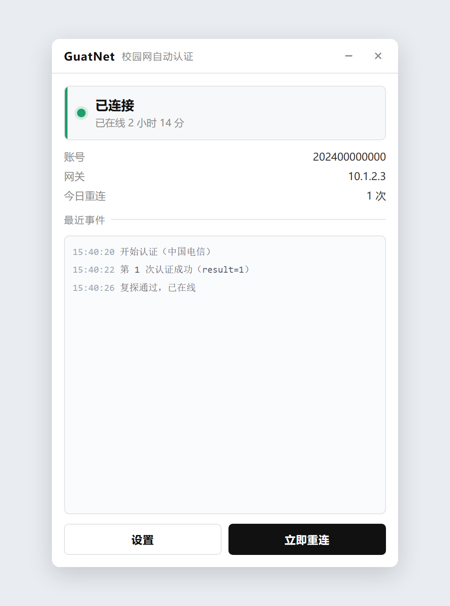
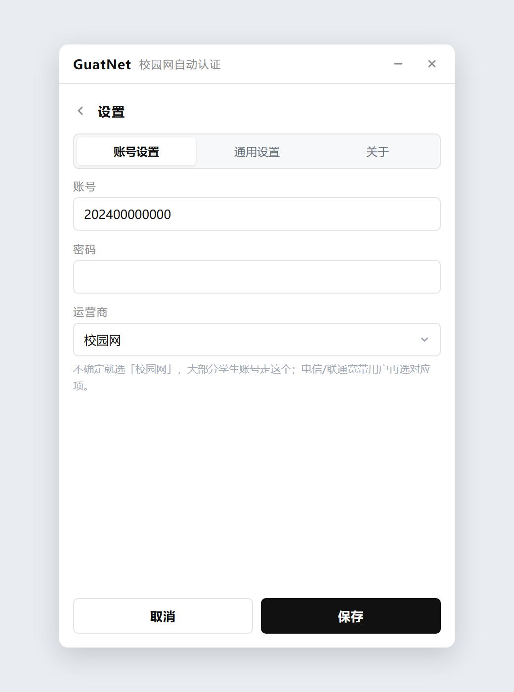

# 桂航校园网自动认证程序

英文名 **GuatNet**（仓库同名）。Dr.COM（城市热点）校园网自动认证 + 断线保活，带托盘和图形界面。

源码：<https://github.com/wmej/GuatNet>

## 界面

<p align="center">
  
  
</p>

- 无边框窗口，标题栏（含状态卡区域）可拖动
- 右上角 `−` **最小化到任务栏**，`×` **收到托盘**
- 窗口大小固定 400×610，想改就改 config.json 的 `windowWidth` / `windowHeight`
- 托盘右键：打开面板 / 立即重连 / 退出；左键单击直接弹面板
- 关掉窗口（`×`）不退出程序，仍在托盘里保活
- 设置分两栏：**账号设置**（账号 / 密码 / 运营商）和 **通用设置**（认证网关 / 开机自启）
- 首次启动弹一次使用须知（非官方声明 + 隐私说明），点「我知道了」后不再出现
- 开机自启默认由安装包勾选，之后可在「通用设置」里随时改
- 「关于」页说明非官方身份、隐私处理方式和实现原理，附上游开源项目链接
- 保存后原子写入配置、按需写注册表，并立刻重新认证一次

## 安装 / 使用

**方式一：安装包**（推荐，发给同学用这个）

安装程序在 [Releases](https://github.com/wmej/GuatNet/releases) 页下载：

- `GuatNet-v<版本>-win-x64-setup.exe` —— 安装版
- `GuatNet-v<版本>-win-x64-portable.exe` —— 绿色版

1. 双击 `GuatNet-v<版本>-win-x64-setup.exe`，一路下一步
2. 附加任务：桌面快捷方式（可选）、**开机自启动（默认勾选）**
3. 运行后在「设置」里填账号、密码、网关

按用户安装，装到 `%LOCALAPPDATA%\Programs\guatnet`，**不弹 UAC**，不需要管理员权限。

**方式二：绿色版**

直接运行 `guatnet.exe`，不写注册表、不建快捷方式。

## 数据存在哪

账号密码和日志写在 `%APPDATA%\guatnet\`：

- `config.json` —— 账号、密码、网关等
- `guatnet.log` —— 运行日志

卸载不会删这个目录，想清干净手动删掉即可。

例外：如果 exe 同目录下**已经存在** `config.json`，程序当作便携模式，改用 exe 目录存放（方便调试）。

## 确认你校的网关地址

程序默认 `10.1.2.3`，各校 Dr.COM 网关不一定相同。

断开认证后，用浏览器打开任意 `http://` 网站，看地址栏跳转到哪里：

```
http://10.1.2.3:801/eportal/?c=Portal&a=login&...
```

其中的 IP（这里是 `10.1.2.3`）填到「设置 → 通用设置 → 认证网关」。端口默认 801，个别学校不同，改 `config.json` 的 `portalPort`。

日志里出现「连不上认证门户」或「认证请求失败」，通常是网关 IP 或端口不对。

## 配置文件

`config.json` 在 `%APPDATA%\guatnet\`，界面保存时会自动写好，一般不用手改。

| 字段 | 说明 | 默认 |
|---|---|---|
| `account` | 学号 / 账号 | 空 |
| `password` | 密码（只存本机） | 空 |
| `isp` | 0 校园网 · 1 校园电信 · 2 校园联通 · 3 校园其他 | `0` |
| `gateway` | 认证门户 IP | `10.1.2.3` |
| `portalPort` | 认证接口端口 | `801` |
| `probeIntervalSec` | 多久问一次门户状态（秒） | `20` |
| `probeTimeoutSec` | 查询门户超时（秒） | `5` |
| `loginTimeoutSec` | 登录请求超时（秒） | `5` |
| `windowWidth` / `windowHeight` | 窗口尺寸（逻辑像素） | `400` / `610` |
| `firstRunDone` | 是否已确认过使用须知 | `false` |
| `logFile` | 日志文件名 | `guatnet.log` |

`jsVersion`、`probeURL`、`failThreshold` 三个字段已不再使用，仅为兼容旧配置保留，可以忽略。

## 开机自启

界面上开：**设置 → 通用设置 → 开机自动启动**，打开开关保存即可。
写入的是 `HKCU\Software\Microsoft\Windows\CurrentVersion\Run`，只影响当前用户，不需要管理员。

命令行方式（任务计划程序）：

```powershell
schtasks /create /tn "guatnet" /tr "\"C:\path\to\guatnet.exe\"" /sc onlogon /rl highest /f
```

删除：

```powershell
schtasks /delete /tn "guatnet" /f
```

## 关于这个程序的身份

**guatnet 不是学校官方软件。** 它由在校学生个人开发，与学校、网络信息中心及运营商没有隶属或授权关系。

- 账号密码只保存在本机 `%APPDATA%\guatnet\config.json`，不上传任何服务器
- 程序唯一的对外请求是向你填写的校内认证网关提交登录参数
- 协议实现参考开源项目 [GuatNetworkLogin](https://github.com/Miuzarte/GuatNetworkLogin)（MIT）

程序内的「设置 → 关于」页也写了这些说明。

## 安全说明

- 密码以**明文**存在 `config.json`。别把它放进网盘同步目录，也别发群里。
- 程序只会向 `gateway` 指定的内网地址发请求，没有任何外部上报。
- 想更保险：右键 `config.json` → 属性 → 安全 → 只保留你自己的用户可读。

## 依赖

- Windows 10/11 自带的 **Microsoft Edge WebView2 Runtime**（系统一般已装；没有的话程序会弹窗提示）
- Go 1.22+（只在你自己编译时需要）

编译：

```bash
# 若替换了 assets/icon.ico，重新生成 exe 图标资源
rsrc -arch amd64 -ico assets/icon.ico -o rsrc_windows_amd64.syso

go build -ldflags="-s -w -H=windowsgui" -o guatnet.exe .

# 打安装包（需要 Inno Setup 6）
ISCC.exe installer\guatnet.iss
```

`-H=windowsgui` 让程序不弹黑色控制台窗口；`rsrc_windows_amd64.syso` 提供 exe 图标。
安装包输出到 `dist\GuatNet-v<版本>-win-x64-setup.exe`。

## 分发

发 `dist\GuatNet-v<版本>-win-x64-setup.exe` 一个文件就行（约 4.2 MB）。

不想装安装包的话，单独发 `guatnet.exe` 也能用——界面和图标都嵌在 exe 里，不用附带 `ui/`、`assets/`。

对方需要的前置条件：

1. **Windows 10/11**，且装有 Microsoft Edge WebView2 Runtime（Win11 和大部分 Win10 已自带；没有的话程序会弹窗提示，去微软官网装）
2. 第一次运行时 Windows SmartScreen 可能拦一下（exe 没有数字签名），点「更多信息 → 仍要运行」

## 已知限制

- 只适配 Dr.COM。其他认证系统（深澜 Srun、锐捷 ePortal）要改 `auth.go` 的参数。
- 网关返回成功但仍上不了网时（少数校区需要客户端二次认证），界面状态会提示"网关已接受，但仍无法上网"。
- 用 Alt+F4 关窗口会销毁 WebView，需要从托盘退出再重开程序。

## 许可证

[MIT](LICENSE) © 2026 wmej

本程序与学校、网络信息中心及运营商无关，非官方软件，按「现状」提供。
